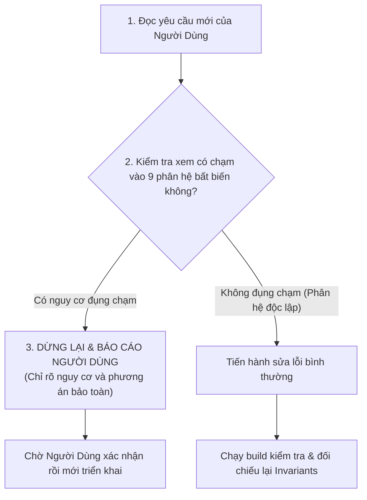

# 🛡️ QUY TẮC BẢO TOÀN HỆ THỐNG & DANH SÁCH BẢN FIX BẤT DI BẤT DỊCH
> **Mục đích:** Tài liệu này ghi nhớ toàn bộ các bản fix cốt lõi của hệ thống CRM Showroom Xe Máy & Dịch Vụ.
> **QUY TẮC BẮT BUỘC CHO TRỢ LÝ AI & LẬP TRÌNH VIÊN:**
> Trước khi thực hiện bất kỳ sửa lỗi hay thay đổi nào sau này, **BẮT BUỘC** phải đọc lại tài liệu này để kiểm tra xem có ảnh hưởng (chạm) tới các tính năng bên dưới hay không. Nếu có nguy cơ ảnh hưởng, **PHẢI BÁO CÁO VÀ HỎI Ý KIẾN NGƯỜI DÙNG** trước khi chỉnh sửa!

---

## 📌 BẢNG TỔNG HỢP CÁC ĐIỀU KIỆN BẤT BIẾN (SYSTEM INVARIANTS)

| STT | Phân hệ | Tính năng / Quy tắc cốt lõi | File liên quan | Điều kiện bất biến (Không được vi phạm) |
| :---: | :--- | :--- | :--- | :--- |
| **1** | **Khảo sát** | Bộ lọc khảo sát bàn giao xe | `api.ts`<br>`CustomerDashboard.tsx` | - Cấm hiển thị bài khảo sát cũ/dummy `KS002` hay `KS-XE-DH-XE-001..004`.<br>- Khảo sát bàn giao xe chỉ kích hoạt khi khách mua đúng dòng xe hoặc đơn xe đó.<br>- Giữ lại bộ lọc `DUMMY_SURVEY_IDS` và `getDeletedSurveyIds()`. |
| **2** | **Khảo sát** | Chức năng xóa khảo sát Admin | `KhaoSatController.cs`<br>`api.ts`<br>`Feedback.tsx` | - Luôn duy trì nút `[🗑️ Xóa]` trên thẻ bài khảo sát và nút `[🗑️ Xóa khảo sát]` trong chi tiết.<br>- Giữ API Backend `[HttpDelete("{id}")]` và `surveyApi.delete(id)`.<br>- Khảo sát đã xóa phải được lưu vào `crm_deleted_survey_ids` để không bị hồi sinh khi F5. |
| **3** | **Đánh giá** | Loại trừ phụ tùng ảo đơn xe | `api.ts`<br>`CustomerDashboard.tsx` | - Đơn hàng xe (`loaiDon === 'Xe'` hoặc `thongTinXe` hoặc mã có `XE`) nếu không mua phụ tùng thì `items` bắt buộc là `[]`.<br>- **CẤM** fallback inject `{ tenSanPham: 'Phụ tùng chính hãng' }` vào đơn xe.<br>- Tab Chờ đánh giá không được sinh thẻ phụ tùng cho đơn xe. |
| **4** | **Lịch hẹn & Lịch biểu** | Lịch nhận xe & Làm mờ khi xong | `api.ts`<br>`CustomerDashboard.tsx`<br>`Appointments.tsx` | - Khi khách bấm *"Xác nhận ngày nhận xe"*, lịch hẹn phải chuyển `DaXacNhan` và đồng bộ tức thì lên Calendar.<br>- Khi đơn xe hoàn thành (`HoanThanh`), lịch hẹn trên Calendar của cả Khách và Admin **VẪN PHẢI HIỂN THỊ NHƯNG LÀM MỜ** (`opacity-40` / `opacity-50`, gạch ngang `line-through`, viền nét đứt). Cấm xóa/ẩn mất khỏi lịch biểu. |
| **5** | **Thông báo** | Điều hướng thông báo đơn xe | `api.ts`<br>`AdminLayout.tsx`<br>`Appointments.tsx` | - Thông báo về đơn xe, xác nhận ngày nhận xe bắt buộc gán `category: 'order'`, `linkPage: 'sales'` để nhảy vào Quản lý đơn hàng.<br>- **CẤM** nhảy sang `appointments` gây trống bảng.<br>- Bộ lọc tìm kiếm trong `Appointments.tsx` phải luôn hỗ trợ `matchDonXe`. |
| **6** | **Bảo hành** | Highlight Yêu cầu bảo hành Admin | `Warranty.tsx`<br>`api.ts` | - `claimsList` và `extensionList` trong `Warranty.tsx` phải nạp đồng bộ bằng `useState(() => warrantyApi.getAdminClaims())`.<br>- Click thông báo bảo hành phải nhảy đúng sang **Tab 2: "Yêu cầu bảo hành"** (`activeMainTab = 'YeuCau'`), reset filter về `TatCa`, chọn claim và cuộn mượt đến dòng đó.<br>- Chỉ xóa `sessionStorage` sau khi đã tìm thấy và xử lý claim. |
| **7** | **Catalog & Đánh giá** | Chuẩn hóa SKU SYM Tuscany 150 | `api.ts`<br>`Feedback.tsx` | - `catalogVehicleApi.getAllSync()` phải tự động hợp nhất các mẫu xe mặc định (đặc biệt `XM042 - SYM Tuscany 150`) vào cache.<br>- Đánh giá của xe SYM Tuscany 150 bắt buộc hiển thị SKU `XM042` và ảnh `/images/Xe/sym_tuscany_150.jpg`, không dùng placeholder `XM-HD01`. |
| **8** | **Biển số** | Bộ lọc phê duyệt biển số xe | `LicensePlateApproval.tsx` | - Xe đã duyệt biển số (`DaDuyet`) phải luôn xuất hiện trong danh sách và đếm đúng thẻ KPI kể cả khi chưa có ảnh cavet. |
| **9** | **Chi tiết xe** | Tab Lịch sử dịch vụ | `CustomerDashboard.tsx` | - Modal Chi tiết xe của khách hàng phải luôn có 2 tab `[🚗 Thông tin phương tiện]` và `[⚡ Lịch sử dịch vụ (N)]`, tra cứu đồng bộ theo ID xe, biển số, mã đơn hoặc tên xe. |
| **10** | **Đặt lịch hẹn & Calendar** | Kiểm tra trùng lịch lái thử, thông báo hủy lịch & sắp xếp hiển thị | `ServiceBooking.tsx`<br>`api.ts`<br>`Appointments.tsx`<br>`CustomerDashboard.tsx` | - **Lái thử xe:** Các slot giờ luôn mở/chọn được cho mọi tài khoản khác nhau; khi submit nếu cùng xe, cùng ngày, cùng giờ -> chặn; nếu cùng xe, cùng ngày, khác giờ -> mở modal xác nhận (Hủy/Tiếp tục).<br>- **Thông báo hủy lịch:** Admin hủy lịch phải gửi thông báo khách kèm lý do (`crm-customer-notification`), hiển thị thẻ lý do hủy và trạng thái Đã hủy trên Dashboard khách.<br>- **Nhắc hẹn sắp tới:** Sắp xếp tăng dần theo ngày & giờ (lịch hẹn gần nhất lên đầu).<br>- **Calendar & Danh sách ngày:** Sắp xếp tăng dần theo giờ; click trực tiếp vào badge lịch hẹn mở modal chi tiết cuộc hẹn. |

---

## 🔍 CHI TIẾT CÁC QUY TẮC CẦN TUÂN THỦ NGHIÊM NGẶT

### 1. QUY TẮC BỘ LỌC KHẢO SÁT & XÓA KHẢO SÁT
* **Vấn đề đã từng gặp:** Khách mua xe Sirius FI nhưng lại nhận thêm bài khảo sát thừa `KS002` ("Khảo sát nhu cầu mua xe Honda SH 160i 2025"); Admin có 34 khảo sát nhưng không thể xóa các bài rác.
* **Quy tắc giữ nguyên:**
  1. Trong `crm-frontend/src/services/api.ts`:
     - `DUMMY_SURVEY_IDS` phải luôn chứa: `'KS002'`, `'KS-XE-DH-XE-001..004'`, `'KS-BD-LH001..003'`.
     - `getDeletedSurveyIds()` đọc từ `localStorage('crm_deleted_survey_ids')`. Mọi phương thức lấy khảo sát (`getAll`, `getAllAsync`) đều phải lọc bỏ các ID này.
     - Hàm `surveyApi.delete(id)` phải thực hiện đủ 4 bước: thêm vào blacklist, xóa cache, xóa `mockSurveys`, gọi backend `DELETE /api/KhaoSat/{id}`.
  2. Trong `CrmBackend/Controllers/KhaoSatController.cs`:
     - Giữ nguyên endpoint `[HttpDelete("{id}")]`.
  3. Trong `crm-frontend/src/pages/admin/Feedback.tsx`:
     - Giữ nguyên nút `[🗑️ Xóa]` trên thẻ khảo sát và `[🗑️ Xóa khảo sát]` trong chi tiết khảo sát, luôn có `confirm()` trước khi xóa.
  4. Trong `CustomerDashboard.tsx` (`DynamicSurveyTab`):
     - Luôn có điều kiện `if (s.id === 'KS002') return false;` và kiểm tra so khớp dòng xe khi bài khảo sát là loại bàn giao xe mới.

---

### 2. QUY TẮC ĐÁNH GIÁ ĐƠN XE (KHÔNG ĐƯỢC CHÈN PHỤ TÙNG ẢO)
* **Vấn đề đã từng gặp:** Khách hàng mua Sirius FI `#DH-XE-008` trên web, sau khi hoàn thành đơn xe thì mục "Chờ đánh giá" vừa hiện xe vừa hiện thêm phụ tùng ảo *"Phụ tùng chính hãng - Đặt mua ngày 2026-10-29"*.
* **Quy tắc giữ nguyên:**
  1. Trong `crm-frontend/src/services/api.ts` (`orderApi.getAll`):
     ```ts
     // BẮT BUỘC: Nếu là đơn xe hoặc mã đơn có XE mà không có chi tiết phụ tùng -> items = []
     : (matchedExisting?.loaiDon === 'Xe' || matchedExisting?.thongTinXe || (item.id && String(item.id).includes('XE')))
         ? []
         : [{ tenSanPham: 'Phụ tùng chính hãng', soLuong: 1, donGia: item.tongTien || 0 }]
     ```
  2. Trong `crm-frontend/src/pages/customer/CustomerDashboard.tsx` (`waitingReviews`):
     ```tsx
     // BẮT BUỘC: Chỉ duyệt items nếu đơn hàng KHÔNG PHẢI đơn xe
     if (o.loaiDon !== 'Xe' && !o.thongTinXe && !String(o.id).includes('XE') && o.items && o.items.length > 0)
     ```

---

### 3. QUY TẮC LỊCH NHẬN XE & LỊCH BIỂU (LÀM MỜ KHI HOÀN THÀNH)
* **Vấn đề đã từng gặp:** Khách hàng bấm xác nhận ngày nhận xe nhưng lịch không hiện; sau khi hoàn thành đơn xe thì lịch biến mất khỏi lịch biểu.
* **Quy tắc giữ nguyên:**
  1. Trong `api.ts` (`orderApi.confirmVehiclePickupDate`):
     - Bắt buộc cập nhật cuộc hẹn sang `DaXacNhan` và gọi `appointmentApi.updateStatus(matched.id, 'DaXacNhan')`.
  2. Trong `CustomerDashboard.tsx` (`myAppts`):
     - **CẤM** thêm điều kiện `if (a.trangThai === 'DaHoanThanh') return false;` cho cuộc hẹn nhận xe (`loaiDichVu === 'NhanXe'`).
     - Khi cuộc hẹn hoặc đơn xe đã hoàn tất, cuộc hẹn vẫn phải nằm trong `myAppts` để Lịch biểu hiển thị dạng làm mờ:
       ```tsx
       // isDone: opacity-40 line-through
       className={`... ${isDone ? 'opacity-40 line-through' : ''}`}
       ```
  3. Trong `Appointments.tsx` (Lịch biểu Admin):
     - Lịch nhận xe khi hoàn tất vẫn được giữ trên ô lịch và hiển thị mờ:
       ```tsx
       className={`... ${isCompleted ? 'opacity-50 line-through bg-zinc-200/90 text-zinc-500 border border-dashed border-zinc-300' : 'bg-zinc-100'}`}
       ```

---

### 4. QUY TẮC ĐIỀU HƯỚNG THÔNG BÁO ADMIN
* **Vấn đề đã từng gặp:** Admin bấm thông báo khách xác nhận ngày nhận xe `#DH-XE-008`, bị nhảy sang Lịch hẹn dịch vụ và tìm kiếm mã đơn xe khiến bảng trống.
* **Quy tắc giữ nguyên:**
  1. Trong `api.ts` (`orderApi.confirmVehiclePickupDate`):
     - Thông báo Admin phải có: `category: 'order'`, `linkPage: 'sales'`, `meta: { orderId: order.id, id: order.id, ...order }`.
  2. Trong `AdminLayout.tsx` (`handleNotificationClick`):
     - Phân giải trang đích: Mọi thông báo có `category === 'order'` hoặc `type` chứa `order` hoặc tiêu đề chứa `đơn hàng` / `đơn xe` đều bắt buộc đặt `targetPage = 'sales'`.
  3. Trong `Appointments.tsx`:
     - Bộ lọc tìm kiếm `apptSearch` luôn phải có `matchDonXe = matchVietnameseSearch((a as any).maDonHangXe || '', apptSearch)` để phòng trường hợp tra cứu mã đơn xe trong trang lịch hẹn vẫn tìm ra cuộc hẹn.

---

### 5. QUY TẮC HIGHLIGHT YÊU CẦU BẢO HÀNH TRÊN ADMIN
* **Vấn đề đã từng gặp:** Khách gửi yêu cầu bảo hành, Admin bấm thông báo nhảy sang trang `/admin/warranty` nhưng kẹt ở Tab 1 "Gia hạn bảo hành", không nhảy sang Tab 2 và không chọn claim.
* **Quy tắc giữ nguyên:**
  1. Trong `crm-frontend/src/pages/admin/Warranty.tsx`:
     - Khởi tạo state bằng hàm callback đọc dữ liệu đồng bộ:
       ```tsx
       const [claimsList, setClaimsList] = useState<AdminWarrantyClaim[]>(() => warrantyApi.getAdminClaims());
       const [extensionList, setExtensionList] = useState<WarrantyExtensionTransaction[]>(() => warrantyApi.getExtensionTransactions());
       ```
     - Khi `handleHighlight` nhận được targetId:
       * Tìm trong `warrantyApi.getAdminClaims()`.
       * Nếu khớp: `setActiveMainTab('YeuCau')`, `setClaimStatusFilter('TatCa')`, `setClaimStaffFilter('TatCa')`, `setClaimSearchTerm(matchedClaim.id)`, `setSelectedClaim(matchedClaim)`, cuộn mượt tới hàng `claim-row-${matchedClaim.id}`.
       * **CHỈ xóa** `sessionStorage.removeItem('crm_admin_highlight')` sau khi đã tìm thấy và xử lý claim thành công.
     - Lắng nghe sự kiện `window.addEventListener('crm-data-refresh', handleUpdate)`.

---

### 6. QUY TẮC MÃ SKU & HÌNH ẢNH XE SYM TUSCANY 150
* **Vấn đề đã từng gặp:** Đánh giá của khách hàng Yến Nhi cho xe SYM Tuscany 150 bị hiện mã placeholder `XM-HD01` và ảnh xe khác.
* **Quy tắc giữ nguyên:**
  1. Trong `crm-frontend/src/services/api.ts` (`catalogVehicleApi.getAllSync`):
     - Luôn hợp nhất `DEFAULT_CATALOG_VEHICLES` (chứa `XM042 - SYM Tuscany 150`) vào cache để đảm bảo không bị thiếu dòng xe này.
  2. Trong `Feedback.tsx`:
     - Logic lấy SKU xe:
       ```tsx
       const sku = (catMatch?.id || (f.productId && f.productId !== 'XM-HD01' ? f.productId : null)) || (cleanProductTitle.toLowerCase().includes('tuscany') ? 'XM042' : null) || f.productId || (isVehicle ? 'XM001' : 'PT001');
       ```
     - Ảnh đại diện sản phẩm trong `getProductThumbnail`: Khi tên xe có `tuscany` hoặc `sym` phải trả về `/images/Xe/sym_tuscany_150.jpg`.

---

---

### 7. QUY TẮC ĐẶT LỊCH HẸN, THÔNG BÁO HỦY LỊCH & SẮP XẾP CALENDAR
* **Vấn đề đã từng gặp:**
  1. Khi một khách hàng đặt lái thử xe vào khung giờ, khung giờ đó bị khóa đỏ với tất cả tài khoản khác khiến người khác không đặt lái thử được xe đó. Đồng thời nếu cùng một người đặt nhiều giờ trong ngày cho cùng 1 xe thì hệ thống không cảnh báo.
  2. Khi Admin hủy lịch hẹn của khách, khách hàng không nhận được thông báo chuông và cuộc hẹn bị biến mất hoàn toàn khỏi danh sách lịch hẹn của khách thay vì hiển thị "Đã hủy" kèm lý do.
  3. Lời nhắc cuộc hẹn sắp tới ở trang chủ khách hàng bị xếp ngược (lịch ngày xa nhất hiện trước thay vì lịch gần nhất).
  4. Lịch biểu (Calendar) và panel bên phải hiển thị thứ tự giờ hẹn lộn xộn; click vào lịch hẹn trên ô Calendar không mở xem được chi tiết.
* **Quy tắc giữ nguyên:**
  1. Trong `crm-frontend/src/pages/customer/ServiceBooking.tsx`:
     - Hàm `isSlotBookedForVehicle`: Trả về `false` đối với dịch vụ lái thử (`svc === 'LaiThu'`), cho phép tất cả các tài khoản khách hàng khác nhau vẫn có thể chọn khung giờ lái thử xe.
     - Kiểm tra submit trùng lặp (`handleSubmitBooking`):
       * Cùng tài khoản khách, cùng xe, cùng ngày, cùng khung giờ: Chặn submit và thông báo lỗi.
       * Cùng tài khoản khách, cùng xe, cùng ngày, khác khung giờ: Mở Modal cảnh báo trùng lặp (`duplicateConfirmModal`) hỏi khách có chắc chắn muốn đặt thêm lịch hay không. Nút "Hủy" đóng modal và không tạo lịch, nút "Tiếp tục" tiếp tục tạo lịch.
  2. Trong `crm-frontend/src/services/api.ts` & `Appointments.tsx`:
     - Khi Admin cập nhật trạng thái lịch hẹn sang `DaHuy`: Bắt buộc tạo thông báo khách hàng `addCustomerNotification` với tiêu đề `❌ Lịch hẹn #[ID] đã bị hủy` và nội dung chứa lý do hủy cụ thể.
     - Phát các sự kiện `crm-customer-notification` và `crm-data-refresh`.
  3. Trong `crm-frontend/src/pages/customer/CustomerDashboard.tsx`:
     - `upcomingAppts`: Bắt buộc sắp xếp tăng dần theo thời gian (`dtA.localeCompare(dtB)`), đưa cuộc hẹn sắp tới gần nhất lên đầu banner.
     - Danh sách lịch hẹn (Tab 2): Không lọc bỏ `DaHuy` và `TuChoi`. Hiển thị thẻ trạng thái "ĐÃ HỦY" cùng hộp cảnh báo lý do hủy (`lyDoHuy`).
     - Ô ngày trên Lịch biểu (`dayAppts`): Sắp xếp tăng dần theo `gioHen`. Cho phép click trực tiếp vào badge cuộc hẹn để mở modal chi tiết (`setSelectedApptDetail(appt)`).
     - Panel bên phải Calendar (`displayedAppts`): Sắp xếp tăng dần theo ngày & giờ (`gioHen`). Click vào thẻ cuộc hẹn để xem chi tiết.

---

## ⚡ LỆNH KÍCH HOẠT NHANH (TRIGGER COMMANDS)

### Lệnh: `.github --update`
* **Cơ chế hoạt động:** Bất cứ khi nào người dùng gõ `.github --update`, Trợ lý AI tự động:
  1. Kiểm tra trạng thái Git (`git status`, `git diff`).
  2. Tạo commit với nội dung mô tả đầy đủ các tính năng / bugfix vừa hoàn thiện.
  3. Push mã nguồn lên branch đang làm việc (`develop`) trên GitHub: `git push origin develop`.
  4. Cập nhật và đè tag checkpoint backup mới nhất: `git tag -f backup-stable-checkpoint; git push origin -f backup-stable-checkpoint`.
  5. Báo cáo lại cho người dùng commit SHA, link checkpoint, và xác nhận đã sẵn sàng backup để có thể rollback bất kỳ lúc nào nếu phát sinh lỗi.

---

## 🚦 QUY TRÌNH CHECKPOINT BẮT BUỘC TRƯỚC KHI CODE LẠI / FIX LỖI MỚI

Khi nhận được bất kỳ yêu cầu sửa lỗi hay tính năng mới nào từ người dùng, Trợ lý AI **BẮT BUỘC** thực hiện quy trình 3 bước sau:



### Tiêu chí cảnh báo khi báo cáo người dùng:
1. Nêu rõ file và hàm sẽ sửa.
2. Nêu rõ tính năng bất biến nào trong tài liệu này có nguy cơ bị ảnh hưởng.
3. Giải trình cách thức sửa đổi để đảm bảo **tính năng cũ vẫn hoạt động 100% không bị suy giảm (no regression)**.
4. Chờ người dùng đồng ý mới bắt đầu sửa.
